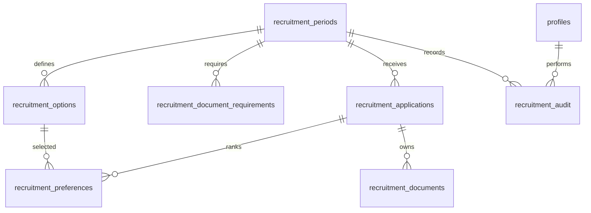

# Phase B2A revised recruitment design

LOCAL, UNEXECUTED SQL design. Updated for confirmed MVP rules, 2026-11-01.
Only `feat/oprec-backend-staging` is in scope. No database or external API was
accessed. SQL files and SQL fixtures have not been executed. Frontend verification
is recorded separately below; it cannot validate PostgreSQL syntax or RLS.

## Confirmed architecture

Applicants are not staff and do not require Auth/profile accounts. The future
submission endpoint accepts a complete application, validates it on the server,
uploads verified files privately, and finalizes once. No self-service correction,
email recovery, capability cookie, or applicant token lifecycle is implemented.
After successful submission, corrections go through the committee. This design
provides no administrative correction endpoint either; that needs a separately
reviewed, audited process. Rejected and withdrawn records keep their NIM reserved.

The two original, not-yet-applied migrations are revised in place. Seven tables
remain: the unused recruitment_access table is removed and an audit table added.
No legacy migration, role helper or voting/authentication policy is changed.

| Table | Keys and purpose |
| --- | --- |
| recruitment_periods | UUID, unique code, immutable approved config version, batches, approval reference/time, exact open/close timestamps, manual open switch. |
| recruitment_options | Composite PK period/main/sub codes; flattened labels, required/optional/none/unconfirmed assignment state, instructions, formats and size. Independent of legacy staff divisions. |
| recruitment_document_requirements | Period/slot PK; five supporting document slots with required flag, formats and size. |
| recruitment_applications | UUID, period FK, unique period/normalized NIM, unique idempotency UUID, canonical request hash, Phase A personal data, status and latest review attribution. Email is NOT unique. |
| recruitment_preferences | Application/rank PK; ranks 1/2, motivation, composite FKs to application/period and configured main/sub pair. Deferred unique application/main/sub prevents identical choices. |
| recruitment_documents | Application/slot unique, opaque object path unique, period/application FK, verified format/bytes/SHA-256/time. |
| recruitment_audit | Append-only API surface: event, period/application/document IDs where applicable, actor profile ID, unique operation request ID, timestamp. No sensitive payload or credential columns. |

No separate applicant, main-division, assignment, recovery or revision-history
tables. Future secure revisions can retain the application ID and add explicit
versioned operations later. No premature editing/recovery mechanism is added now.

## Personal fields, preferences and documents

Phase A mapping: fullName/full_name, nim/nim, birthPlace/birth_place,
birthDate/birth_date, ugmEmail/email, phoneNumber/phone, major/major, batch/batch.
The generic email column reflects the existing syntax-only email validation; no
unconfirmed university-domain restriction is invented.

Exactly two preferences are required at finalization, with rank 1 and rank 2.
Different sub-divisions in the same main division are allowed. The exact same
configured main/sub pair cannot be selected twice. Sub-code identity is scoped
by its main division in the catalogue; if future catalogue imports use aliases
for one actual sub-division, approval must reject those duplicate identities.
Deferred uniqueness permits a future authorized transactional rank swap without
weakening the committed-state invariant. No post-submit swap is exposed now.

Frontend validates distinct choices when progressing either preference and on
final submit. Both database FKs and the finalization trigger validate the chosen
configuration. Changing a choice clears that rank's assignment; the other rank
and supporting documents are preserved. Duplicate errors are cleared/recomputed
when either choice changes. Parent-child validation still rejects mismatched codes.

Supporting slots: cv, idCard, commitment, followProof, storyProof. Proposed Phase A
formats are PDF for the first three, PNG for the last two, all required, 3 MiB max.
Assignment slots are assignment1/assignment2, driven by that rank's chosen option:
required needs a valid file, optional validates if present, none forbids a file,
unconfirmed blocks submission. PDF/PNG/PPT/PPTX support is driven by approved rules.

Migration inserts NO catalogue or requirements. Draft guidebook and synthetic demo
remain distinct frontend data, never approved database configuration. Approval
requires all five supporting slots, a nonempty catalogue, consistent parent labels,
and no unconfirmed options. Approved rows freeze; only the period open switch can
change. Amendments require a separately reviewed configuration/version policy.

## Duplicate prevention and retry contract

Normalize NIM with lowercase/trim consistently on the server and in database
checks. A unique `(period_id,nim)` constraint applies to ALL statuses, including
uploading, rejected and withdrawn. Email changes cannot bypass it. No email-only
upsert, takeover or recovery is allowed. Separate people sharing an email are
not prohibited by this schema; identity uniqueness is based on normalized NIM.

The future server generates/accepts a high-entropy idempotency UUID, computes a
canonical request hash over normalized values, ordered preferences and verified
file hashes, and stores both when creating the uploading row. Never trust a
client-supplied hash. Same key with different content is a conflict; same NIM with
a different key is a duplicate, not a new application. Concurrent insertion is
serialized by database uniqueness. A retry must never upsert over existing data.

`recruitment_finalize(application,key,hash)` is service-role-only and row-locks the
application, checks key/hash and normalized NIM uniqueness, then transitions an
uploading row exactly once. Repeated matching calls return the same receipt ID
without another submission audit or reopening a terminal record. Server must
compare stored request hash before resuming any uploading attempt, revalidate the
complete canonical payload before finalize, and reject changed retries. A UUID
or hash is not proof of ownership. Public retries return only a minimal receipt
or generic response, never applicant PII/documents or a recovery/edit session.

This is the database primitive and server contract, not a wired backend endpoint.
Partial failed attempts need server-managed retry/orphan handling with no applicant
edit API. Do not delete uploading rows and release NIM automatically without an
approved abandonment policy. Do not turn an existing NIM into an enumeration API.

## Status and immutable submission

uploading -> submitted -> under_review -> accepted/rejected
submitted or under_review -> withdrawn (future authorized committee process only)

No post-submit personal/preference/document editing is permitted. Terminal states
do not reopen. Review RPC sets reviewer and time from authenticated identity.
Exactly-two preferences, document rules, Storage object presence, personal checks,
approved active period and the UTC window `[opens_at,closes_at)` are checked on
submission. Birth-date cutoff uses Asia/Jakarta. Application/child locks serialize
finalization with child writes; a period share lock serializes pause vs finalize.

Indexes cover normalized NIM and idempotency uniqueness, period/status queue,
option/preference lookup, documents by period/application and audit chronology.
FKs retain applications/configuration/documents via RESTRICT; reviewed profiles
and audit actors cannot be deleted without an explicit retention decision.
Deactivate staff instead. No automatic retention/deletion job is supplied.

## Authorization and private storage

`recruitment_allowed(period,permission)` checks auth.uid() against the CURRENT
profiles row with role='super_admin' AND is_active=true, plus an existing period
and recognized permission. All active super-admins receive review, document and
export authorization for all recruitment periods; no per-period grant duplication.
No ordinary admin, no-profile user or inactive super-admin qualifies. Existing
JWTs lose access on the next statement after deactivation or role demotion.
Legacy `is_super_admin()` remains untouched and is not called by recruitment.

All seven tables enable RLS and revoke public/anon/authenticated default grants
before the schema migration commits. Public configuration reads expose only
approved safe columns. Submitted-and-later application, preference and document
metadata reads require the new helper. Uploading rows and request hash/key are
not staff-readable. Staff cannot directly mutate tables; narrow review/export
RPCs check the helper. Server endpoints MUST independently verify the user and
current profile for every operation; rendering an admin page is insufficient.
Service keys bypass RLS and remain server-only, never accepted from browsers.

The private recruitment-documents bucket is 3 MiB/object with the permitted MIME
allowlist. Bucket-name conflict aborts. Restrictive Storage policies deny every
direct anon/authenticated bucket/object operation, including for super-admins;
other buckets and legacy policies stay unchanged. Opaque names are
`period UUID/application UUID/document UUID.format`, never names/email/NIM.

Future download endpoint verifies Auth identity/current active super-admin,
calls recruitment_document_access with the USER JWT, then uses the returned exact
path to stream using its server-only service client. No arbitrary paths, public
URLs, cacheable responses or browser service keys. Recheck each request/range,
use private/no-store attachment headers, and do not log bytes/filenames/PII.
Signed download URLs are not implemented; they would remain usable until expiry
following deactivation. Already delivered bytes cannot be revoked.

Future submission endpoint must rate-limit/bot-protect, validate request sizes,
sniff actual file signatures, parse/scan content, enforce per-rule format/size,
generate paths, upload without overwrite, then insert server-verified metadata.
A complete-request server workflow avoids persistent applicant tokens. Hosting
request limits for up to seven files, safe PPT/PPTX scanning and orphan cleanup
remain implementation blockers. SQL existence checks cannot validate file bytes
or prove Storage API behavior. No server route is added in this phase.

## MVP audit semantics and limits

- Submission: AFTER status transition trigger inserts an event in the same
  transaction, keyed by submission idempotency UUID. Exact retry adds no event.
- Review: transition trigger requires active super-admin and records actor and
  application. Review and event roll back together on failure.
- CSV export: RPC records actor/period/page authorization in the same transaction
  before returning its bounded result (maximum 500 records/page). It returns
  JSON rows for future server CSV serialization, NOT a CSV implementation.
- Document download: metadata-access RPC records document_download_authorized
  with actor/application/document. Server streams afterward. This proves an
  authorization event, not successful delivery or a count of bytes downloaded.

Audit has no ordinary-role policies or table grants, and direct service-role
writes/updates/deletes are revoked. Only owner-executed narrow functions insert;
a database owner remains trusted. No public audit query API is exposed.
Audit contains no raw documents, tokens, passwords, hashes or full personal
payload. Retention, failure logging and a secure audit-review workflow remain
operational decisions. Denied requests need a separate redacted server security
log; rolled-back transactions do not persist denial audit events.

Direct authorized RLS application/metadata SELECTs ARE NOT AUDITED. Browser or
caller can invoke allowed RPCs directly; export/review/document authorization
still logs in the database. Users can copy readable records without calling the
CSV RPC. Do not claim all reads, all copying or completed downloads are audited.
RPC export is not a multi-page consistent snapshot. CSV formula escaping,
per-page endpoint authorization, no-store headers and rate limits remain server
implementation requirements.

## Legacy migration dependencies and execution ordering

| Existing migration | Recruitment dependency |
| --- | --- |
| 20260917000000_admin_profiles | Direct profiles ID/role and auth.uid/Auth identities. |
| 20260917010000_divisions | None; recruitment catalogue is independent. |
| 20260917020000_profile_details | None; applicant personal fields are separate. |
| 20260918000000_elections | None; no voting reuse. |
| 20260919000000_super_admin_dashboard | Direct profiles.is_active. |
| 20260919010000_account_period | None; staff period is not an access grant. |
| 20260919020000_rekap | None. |
| 20260919030000_proker | None. |
| 20260919040000_division_overview | None. |
| 20260919050000_election_admin | None. |
| 20260919060000_voting_controls | None. |
| 20260919070000_candidate_photos | None; public bucket never stores applicant files. |
| 20260922000000_meetings | None; no Realtime dependency. |
| 20260922010000_division_overview_service_role | None. |
| 20260930000000_update_competencies | None. |

Maintain complete 15-file legacy order, then 20261101000000_recruitment_schema.sql,
then 20261101010000_recruitment_security.sql: 17 migrations total. Requires standard
Supabase Auth/Storage schemas/API roles, UUID generation and migration-owner
privileges. These two files are transactional individually, not as a pair.
If security fails, the first file still leaves API tables/functions denied.
No application process or fixtures should run against a partial migration set.

No down migration: stop intake, inspect history and use a reviewed forward fix.
Deleting submitted children is intentionally blocked by guards; any authorized
retention/rollback requires a scoped maintenance path, ordered removal of actual
objects using Storage API, then rows/functions/policies. Never delete Storage
object rows directly in an operational rollback, disable legacy policies, use
blind CASCADE, or assume exports can be recalled.

## SQL tests: authored, NOT EXECUTED

supabase/tests/recruitment_design.sql is a rollback-only integration suite for an
explicitly authorized disposable LOCAL owner connection after all 17 migrations.
It creates synthetic Auth profiles only when eventually executed. Its SQL Storage
rows are synthetic test metadata, not a substitute for a Storage API test.

Cases include approval/immutability, two different same-parent options, deferred
identical-choice rejection, missing preference/doc rejection, normalized NIM
uniqueness with changed email, immutable submitted data, successful finalization
and idempotent replay/conflicting hash, active super-admin across periods without
grants, ordinary/inactive denial, stale JWT deactivation, narrow column access,
review transitions, export/document authorization, submission/review audit checks
and private bucket/anonymous denial. All remain unverified until executed.

Required expanded isolated matrix: withdrawn/rejected/expired drafts never free
NIM, same email/different NIM allowed, normalized case/space variants, concurrent
same-NIM/key requests, content mismatch retries, unknown/expired operation IDs,
actual finalized-row denial after role demotion/deactivation, every terminal
transition, audit failure atomicity and no sensitive audit payload, all four
assignment states at both ranks, exact deadline/manual pause races, real Storage
API list/get/upsert/move/copy denial even with a broad permissive policy, malicious
files/scanner failure, download cross-application path tampering, CSV injection,
and server Auth/CSRF/rate-limit/redaction tests. SQL is not frontend validation.

## Remaining decisions and exact gate

Confirmed: distinct sub-divisions, same parent allowed; one NIM/period forever in
MVP; no self-service revisions/recovery; all active super-admins administer all
periods; private documents and audited sensitive operation pathways.
Still pending: official catalogue/assignment rules, calendar, consent version and
collection basis, retention, NIM verification/protection against impersonation,
normalized NIM punctuation/Unicode policy, committee correction procedure,
abandoned upload treatment, safe scanning and endpoint hosting limits, CSV field
minimization and operational audit retention/access. No real PII collection
before these are approved and the server security contract is implemented.

Execution remains forbidden in this task. Before isolated SQL testing obtain
explicit approval for a disposable LOCAL Supabase stack and synthetic fixtures;
verify pinned tooling, reviewed migration hashes and no cloud target/environment.
Run full history, suite and expanded matrix only within that authorized phase.
A later cloud staging dry-run needs separate approval and independently checked
personal organization ID, project ref, project name, endpoint, DB identity and
key provenance. Verify all 17 files; dry-run contacts staging. Actual migration
execution requires another explicit approval for the exact target and reviewed
set. Never connect to the other organization's production project, use legacy
seeds, push or deploy as part of these approvals.

## Frontend verification

See B2A-revision-verification.md for actual local run results. Frontend mock stays
memory-only and credential-free, with no official submission or backend integration.
