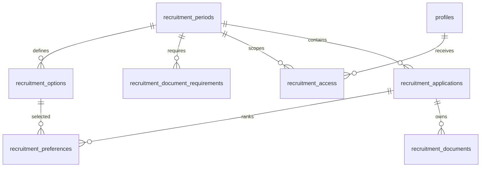

# Phase B2A — recruitment database and authorization proposal

Status: LOCAL DESIGN, UNEXECUTED, 2026-11-01. Branch inspected:
`feat/oprec-backend-staging`. No project, database, SQL engine or external API was
accessed. No credentials were opened. No account, bucket or row was created.
SQL tests below are files, not test results. No frontend/backend routes are wired.

## Design decision and relationships

Seven recruitment tables keep the MVP separate from legacy staff divisions and
voting. Applicants have no `profiles` or staff/Auth account requirement. A future
server endpoint mediates anonymous submissions using an expiring capability
cookie. This avoids adding public write RLS or treating applicants as staff.

| Table | Responsibility / keys |
| --- | --- |
| `recruitment_periods` | UUID PK, unique code, version, batch allowlist, exact UTC open/close timestamps, approval reference/time, manual open switch. |
| `recruitment_options` | Composite PK `(period_id, main_code, sub_code)`; flattened main/sub names, assignment state, instructions, format/size rules. |
| `recruitment_document_requirements` | PK `(period_id, slot)`; five supporting-document slots, required flag, allowed formats, max size. |
| `recruitment_access` | PK `(period_id, profile_id)`; explicit review/export booleans, revocation timestamp, grant reference. Profile FK, no implicit legacy role grant. |
| `recruitment_applications` | UUID PK, period FK, personal fields, status, session capability hash/expiry, idempotency key, last review attribution. Unique period/NIM and period/normalized email. |
| `recruitment_preferences` | PK `(application_id, rank)` with rank 1 or 2; motivation and composite FK to the selected period/main/sub option. Composite application/period FK prevents crossing periods. |
| `recruitment_documents` | UUID PK, application/period FK, unique application/slot and object name; private bucket, opaque path, verified format/bytes/SHA-256/time. |



No separate applicant, main-division, assignment, file-version or workflow-engine
tables. Flattening repeats the main label; approval validates consistent labels
per main code. A new period/version is a new row set, never a catalogue overwrite.
The single application row contains the latest review only, not a historical
review audit; a future append-only audit sink is required before real use.

Phase A field mapping: `fullName→full_name`, `nim→nim`, `birthPlace→birth_place`,
`birthDate→birth_date`, `ugmEmail→email`, `phoneNumber→phone`, `major→major`,
`batch→batch`. `division1/2`, `subDivision1/2`, `motivation1/2` map to ranks 1/2.
The email column name deliberately does not claim university-domain validation:
Phase A currently accepts general syntactically valid email addresses.

Document slots: `cv`, `idCard`, `commitment`, `followProof`, `storyProof`,
`assignment1`, `assignment2`. Proposed initial supporting rules match Phase A:
first three PDF, last two PNG, all required, max 3 MiB each. These are design
values only; migration inserts NO requirements or catalogue. Assignment formats
support Phase A's PDF, PNG, PPT and PPTX but no sub-division has been approved.

## Dependencies from all 15 existing migrations

| Existing migration | Recruitment dependency / assessment |
| --- | --- |
| `20260917000000_admin_profiles` | Direct: `profiles.id`, Auth identity and profile FK. New helpers do not reuse `is_super_admin()` because it does not check activity. |
| `20260917010000_divisions` | No direct dependency; staff may still belong to legacy divisions. Recruitment option codes are independent. |
| `20260917020000_profile_details` | No direct dependency; applicant information stays outside staff profiles. |
| `20260918000000_elections` | None. No candidate/vote table or policy is reused. |
| `20260919000000_super_admin_dashboard` | Direct: `profiles.is_active`. Every recruitment permission lookup joins the live flag. |
| `20260919010000_account_period` | None. Staff period strings do not grant recruitment period access. |
| `20260919020000_rekap` | None; no `manages_profile` or competency coupling. |
| `20260919030000_proker` | None; broad pengurus listing is not a recruitment authorization primitive. |
| `20260919040000_division_overview` | None; catalogue/name updates do not initialize recruitment. |
| `20260919050000_election_admin` | None; election admin functions remain unchanged. |
| `20260919060000_voting_controls` | None; recruitment statuses have separate semantics. |
| `20260919070000_candidate_photos` | No bucket dependency; its public bucket must NEVER contain applicant files. Restrictive recruitment Storage fences do not change its policies. |
| `20260922000000_meetings` | None; no attendance/Realtime dependency. New tables are not added to Realtime. |
| `20260922010000_division_overview_service_role` | None; illustrates server privilege boundary, not recruitment access. |
| `20260930000000_update_competencies` | None; recruitment uses no competency constraints or RPC. |

Supabase platform dependencies: Auth schemas/functions, built-in API roles,
`storage.buckets`, `storage.objects`, UUID generation, and migration-owner
privileges sufficient for SECURITY DEFINER functions and Storage policies.
Direct legacy prerequisites are the base profiles migration and active flag;
the maintained deployment path nevertheless runs the complete ordered 15-file
history first, then the two new files. Do not cherry-pick against unknown history.

## Configuration approval and submission invariants

Only the trusted maintenance/service path can edit draft configuration or access
grants. Staff cannot approve catalogues or grant themselves access through SQL/API.
An approval reference records an externally reviewed decision; the database
cannot determine whether an actual committee approved it. No draft/demo import
exists. `approvedRecruitmentPeriods` in Phase A remains empty and untouched.

Approval requires a nonempty options catalogue, all five supporting slots,
consistent main labels and zero `unconfirmed` options. After approval, period
fields and child rules freeze; only `is_open` can change. This intentionally
blocks publishing a partially confirmed catalogue. A correction requires a
separate reviewed migration/versioning decision, not silently changing old rules.

Application flow:

```text
uploading → submitted → under_review → accepted
                                   ↘ rejected
            submitted / under_review → withdrawn
```

Accepted/rejected/withdrawn are terminal for this proposal. Uploading records are
server-side staging for file collection, not a public draft dashboard. Initial
personal fields must already validate. Abandoned drafts need a later cleanup job.
Exactly two rows with distinct rank keys are enforced at submission; zero/one is
allowed during upload. Whether the same sub-division or main division may appear
twice is an unresolved rule: SQL currently permits it, matching Phase A's lack of
a distinct-choice check. Do not infer a prohibition from the word 'ranked'.

The submission trigger locks/checks the approved period, manual switch and UTC
window `[opens_at, closes_at)`, batch, nonfuture birth date in Asia/Jakarta and
capability expiry. It checks both preferences and required/optional/none rules,
five supporting requirements, file format/size metadata, and referenced Storage
object existence. `required`: must exist; `optional`: may be absent but validates
when present; `none`: must be absent; `unconfirmed`: blocks approval/submission.

Child writes lock their application row. Finalize and child edits cannot race
past each other. Submitted personal data, preferences and document metadata are
immutable; row-level transitions prevent bypass through a privileged status update.
The review RPC permits only review transitions and sets reviewer/time itself.
Concurrent calls serialize on the application row. The trigger does not verify
file contents or capability possession: those remain trusted-server duties.

Duplicate proposal: one normalized NIM AND one normalized email per period;
withdrawal does not release either. Names/NIM lengths and motivation bounds match
Phase A; NIM normalization is lowercase/trim (no invented numeric-only regex).
No cross-period uniqueness. A unique client idempotency UUID permits safe retries
only when server capability binding also matches; it is not authentication.

Indexes: composite catalogue/requirement/access/preference keys, access lookup
by profile, application queue `(period,status,submitted_at,id)`, normalized
identity uniqueness, preference option lookup, and document period/application
lookup. FK retention uses RESTRICT for application content and periods; automated
deletion must use an explicit ordered retention workflow. Deleting a staff profile
revokes its access by cascade, but last-review attribution restricts deletion;
deactivate staff instead. Legacy auth deletion workflows may need to handle this.

## Authorization and RLS matrix

All seven tables enable RLS and reset default PUBLIC/anon/authenticated privileges.
All writes have no ordinary-role policies or grants. SECURITY DEFINER helpers
have empty search_path, qualified relations, explicit execute revokes and narrow
grants. Trigger functions are not RPC entry points. The migration owner/service
role remains a trusted bypass; RLS is not a defense against leaked server keys.

| Actor | Configuration | Applications/preferences/metadata | Review | Export | Storage directly |
| --- | --- | --- | --- | --- | --- |
| Anonymous applicant | Approved safe columns only | Denied; server capability path only | Denied | Denied | Denied |
| Auth user without recruitment grant | Approved only | Denied, even legacy super-admin | Denied | Denied | Denied |
| Active period reviewer | Approved only | Submitted-and-later records in assigned period | Narrow JWT RPC | Denied without `can_export` | Denied |
| Active period reviewer + exporter | Same | Same | Same | Bounded JWT export RPC | Denied |
| Inactive/revoked staff, existing JWT | Approved public configuration only | Denied on next statement | Denied | Denied | Denied |
| Trusted server/service role | Privileged; endpoint must validate request purpose | Privileged; capability or staff authorization required | Use caller JWT RPC, not service impersonation | Use caller JWT RPC | Private server-mediated access |

`recruitment_allowed(period,permission)` reads `auth.uid()`, `profiles.is_active`,
explicit grant and revocation for EVERY statement. It accepts no user-ID override
and does not trust a role/permission embedded in an old JWT. Export implies review.
Staff cannot read capability hashes, expiry or idempotency tokens via column
grants; use an explicit projection rather than `SELECT *`.

Review privilege necessarily allows reading/copying visible records; `can_export`
controls the supported bulk-export operation, not prevention of screenshots or
manual enumeration. Export is period-scoped, max 500 records/page, cursor by UUID;
no capability, object path or internal review notes. It is not a consistent
multi-page snapshot while statuses change. Server CSV escaping (including formula
injection), rate limits, permission recheck per page and an audit event are
required. Direct RPC callers can invoke the permitted export without a server
audit today; before real data, add database-level export/review audit or restrict
RPC transport appropriately. This is a release blocker, not a claim of auditing.

## Private storage and future server protocol

Bucket SQL declares `recruitment-documents`, `public=false`, 3 MiB per object,
and allowed MIME types matching Phase A. Existing bucket conflict aborts rather
than retaining potentially public settings. Restrictive policies exclude this
bucket for all anon/authenticated object and bucket operations, even if another
permissive policy is later broadened. No public URLs, browser list/download or
client-side service keys. Existing legacy bucket policies are not changed.

Object names: `<period UUID>/<application UUID>/<document UUID>.<format>`.
No real names, emails, NIM or original filenames. Metadata is committed only
AFTER a verified upload. No FK to Storage internals; metadata and object deletion
cannot be an atomic transaction across SQL and the Storage API. SQL checks
existence at submission, not continued availability, bytes or antivirus results.

Future implementation contract (NOT implemented in B2A):

1. Public endpoint fetches a specific server-approved period, never trusts posted
   rules, labels, MIME, size, status, period approval or permission. Revalidate
   period/batches and both composite option keys on start, upload and finalization.
2. Rate limit and bot-protect before any service call; enforce origin/CSRF checks
   for cookie mutation. Issue at least 256 random bits as a Secure/HttpOnly/SameSite
   session cookie, store only SHA-256, bind to application ID and expiry. UUID,
   email and NIM alone never authorize retrieval or editing. Hash/check safely,
   no token in URL/logs, no generic applicant list endpoint. Local transport rules
   for cookies need a separate development-only decision.
3. Stream uploads through server with per-file and total-request size limits,
   bounded memory/time, capability + open-period check. Validate extension AND
   sniff actual bytes, parse accepted formats, reject malformed/polyglot or
   malicious content, scan before marking verified. PPT/PPTX support requires
   a safe parser/scanner; if unavailable, do not approve those formats. No fetching
   user URLs or trusting browser MIME. Do not expose private values in errors.
4. Generate object IDs/path on server and upload with overwrite disabled. This
   version deliberately has no browser signed-upload token; avoid token paths
   that bypass application checks. If replacement is allowed while uploading,
   upload a new ID, swap metadata under lock, then remove the old object through
   Storage API with retries; never overwrite an approved file in place.
5. Insert verified metadata with server-measured SHA/size/format only. Finalize
   with a single service update to `submitted`; the trigger is the last database
   gate. Return an opaque receipt, not public document links. Treat duplicate
   errors generically to avoid identity enumeration. Multi-step failed uploads
   need compensation and expiry-based orphan cleanup with grace periods.
6. Staff use verified Auth JWT and `recruitment_allowed` for the relevant period;
   never authorize using caller-supplied profile ID or legacy role alone. Review
   and export run as the user via their RPCs. For document access, use the user
   client to fetch RLS-visible metadata first, then server service client streams
   that exact object. Recheck authorization each request/range, prohibit arbitrary
   object paths, send private/no-store attachment response and audit the action.
7. Prefer server streaming to signed download URLs: it allows new requests to
   stop after revocation. Any future signed URL is a bearer token usable until
   expiry, even after staff deactivation; keep TTL short and document the residual
   access. No design can retract already downloaded bytes or an in-flight stream.

## Automated tests and evidence limits

`supabase/tests/recruitment_design.sql` is an UNEXECUTED transactional integration
suite using synthetic users/catalogue only, no passwords or outbound messages.
It requires a disposable LOCAL Supabase owner session, all migrations, and an
approved test run. It uses ordinary DO/assertions plus `pg_temp.expect_error`,
not pgTAP. It rolls back and fails loudly on a missing expected error. On failure
disconnect/rollback; never continue in an aborted transaction.

The authored cases cover draft/approval validation, approved immutability, missing
preferences/docs, uploading privacy, column secrecy, export denial, grant-edit
denial, period isolation, inactive staff and explicitly revoked grants, stale JWT
deactivation, super-admin without grant denial, anonymous privacy and private
bucket configuration. They are NOT a complete security certification or a proven
passing suite. Synthetic test approval references are not organization approval.

Required additional integration/API tests before a release (not executable here):

- Successful submission with all five actual synthetic objects; exactly ranks
  1/2, reject 0/3/duplicate ranks, cross-period FKs and wrong main/sub pair.
- Required/optional/none/unconfirmed combinations at both ranks; optional omitted
  and supplied; support slot format/size rules; missing Storage object.
- Empty/3-MiB/3-MiB+1, mismatched MIME/extension/signature, corrupt PDF/PNG/PPT,
  ZIP bombs/PPTX decompression limit, malicious documents and scanner outage.
- Window before/open/exact close/manual pause, capability expiry, invalid batch,
  future/invalid birth date, normalized duplicate identity, repeat idempotency
  with same versus different capability, tampered payload and foreign capability.
- Happy review/export and both explicit grant revocation and staff deactivation
  against actual submitted rows with an existing JWT; cross-period attempts,
  unknown permission, no-profile user, no grant self-escalation, all forbidden
  state transitions and terminal edits. Authenticated direct writes must fail.
- Direct Storage API list/get/upload/update/delete/upsert/move/copy and signed
  token attempts as anon/reviewer/inactive staff. Add a broad permissive policy
  in the disposable DB and prove restrictive fences still deny this bucket while
  legacy candidate-photo behavior remains unchanged. Never simulate Storage API
  correctness merely by inserting a SQL metadata row.
- Two connections race finalize vs child mutation, pause vs submit, two same
  identities, duplicate review, grant revocation and expiry cleanup. Define allowed
  linearization at statement start; revocation cannot recall a previous response.
- Service-key endpoints must be tested separately: RLS tests cannot prove server
  capability validation, CSRF, audit, redaction, CSV formula escaping, caching,
  upload cleanup, rate limits, or absence of cross-app document access.
- Replay entire clean history, check actual function/column grants and ownership,
  compare legacy schema/policies before/after; migration rollback-on-error and
  bucket-name conflict abort. No claim that source inspection compiles PL/pgSQL.

## Unresolved decisions and conservative proposal defaults

Business sign-off is still required for duplicate identity/reapplication policy,
same-option preferences, approved division/assignment catalogue, actual calendar
and Jakarta cutoffs, university email restriction or identity verification,
applicant corrections/withdrawal/recovery, review results and appeals, and any
per-division reviewer filtering. This MVP grants period-wide access, not division
filtering. Do not grant it if committee members should see only their own choices.

Privacy/operations sign-off: consent wording/version, lawful collection of birth
details and ID cards, retention/deletion deadline, upload-session TTL, max total
request size, malware scanning service, audit retention/sink, export field
minimization, reviewer download permission, admin provisioning/revocation process,
whether only one period may be open, and future configuration amendments.
No consent table or invented consent checkbox is added without a decision.
Before real collection, record approved consent version/time in the application
schema and implement retention/audit; current SQL is not ready for real PII.

## Ordering, rollback and exact execution gate

New migration order AFTER the 15 existing files:

1. `20261101000000_recruitment_schema.sql` — seven tables, constraints, indexes,
   approval/content/finalization triggers.
2. `20261101010000_recruitment_security.sql` — grants, RLS, permission/review/export
   functions, private bucket declaration and restrictive Storage policies.

Both files contain explicit transactions, but the pair is NOT one transaction.
The schema file enables RLS, revokes API table privileges and trigger-function
execute before committing, so a failed security file leaves a closed API surface.
Until security succeeds, no application processes should run and no data should
be inserted. All policies/privileges need verification in the isolated test
database. No real dataset may enter an incompletely migrated target.

If security migration fails, do not retry blindly or make the bucket public.
Inspect applied history and owner privileges, correct forward in an empty test
environment. For nonempty staging prefer forward corrective migrations. Before
any destructive rollback, stop intake, revoke routes, inventory private objects,
securely preserve only authorized data, remove files using Storage API, then
delete metadata/preferences/applications/access/config children/periods, remove
RPCs/triggers/functions/tables and the two bucket-specific fences/bucket only
after dependencies are understood. Never delete Storage object rows directly,
never use CASCADE blindly and never alter legacy policies/auth/voting objects.
Content guards intentionally reject deleting submitted child rows; an eventual
retention/down migration must introduce an explicitly reviewed maintenance path
before that deletion order can run. No generic delete endpoint or retention
runner is implemented. No runnable down migration is supplied because deleting PII/buckets needs a
separate approved data-handling decision. Rollback does not retract exports.

Execution gate (B2A authorizes NONE of these operations):

1. Obtain approval to implement/test the staging target guard and install any
   required local tooling. Version-specific Next.js docs are absent with
   `node_modules`; no Next.js application code was changed here.
2. Resolve business/security blockers and review exact SQL hashes/diff; approve a
   disposable LOCAL Supabase rehearsal and test fixtures explicitly. Test all 17
   files with no legacy production seeds, then the SQL suite and remaining matrix.
3. Obtain distinct approval to CONNECT to personal-organization staging and run
   a remote dry-run. Independently verify organization ID, exact project ref,
   `spe-ugm-staging` name, endpoint, DB identity, blank/known history and key
   provenance. Never connect to the other organization's production project.
4. Apply the B1 fail-closed environment/CLI checks. Inspect pinned CLI help;
   proposed command remains `supabase db push --dry-run --db-url "$env:STAGING_DB_URL"`.
   It is a network operation and is not authorized here. No DSN logging/debugging.
5. Compare preview to all **17** expected migrations (B1's 15-file count is now
   superseded for this branch), disclose both bucket side effects, present local
   test evidence and redacted preview. Any mismatch blocks execution.
6. Obtain explicit approval of actual STAGING migration execution for that exact
   reviewed set and independently verified target. Reverify immediately before
   the write. No implicit linked target, seeds, storage uploads, account creation,
   deployment or production access is included in migration approval.

## Exact B2A file changes

- Added `supabase/migrations/20261101000000_recruitment_schema.sql`.
- Added `supabase/migrations/20261101010000_recruitment_security.sql`.
- Added `supabase/tests/recruitment_design.sql` (not run).
- Added this design/report file.

No legacy migrations, authentication/voting policies, Phase A modules, package
scripts/dependencies, B1 artifacts or environment files were modified. No SQL or
test suite was run, no privileged account created, and no database accessed or
modified. Source review and whitespace checks are the only validation in B2A.
